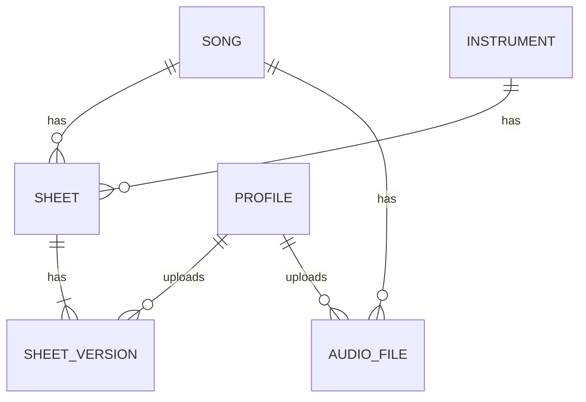

# Technical Docs

## Overview

Sound Leaves is a music sheet and audio organizer for **one band** (one instance per band).

The whole app should be built to be viewed on desktop and on mobile:

- **Mobile** focuses on uploading files and scanning documents.
- **Desktop** focuses on the management side, to keep an overview of all the information.

## Setup and Technologies

- React Frontend App hosted on Cloudflare Pages
- Supabase Postgres Database for Metadata (+ Supabase Auth for logins)
- Cloudflare R2 for pdfs and audio files

## Users and Roles

All band members log in. There are two roles:

| Action                                   | Member | Admin |
| ---------------------------------------- | :----: | :---: |
| View songs, sheets, audio                |   ✓    |   ✓   |
| Play (Playing View)                      |   ✓    |   ✓   |
| Upload sheets / sheet versions / audio   |   ✓    |   ✓   |
| Create / edit songs and instruments      |        |   ✓   |
| Delete songs, instruments, files         |        |   ✓   |
| Manage members and roles                 |        |   ✓   |

## Data Model

- **Song** and **Instrument** are many-to-many: each instrument plays multiple songs, each song contains all instruments.
- The song × instrument grid is **strict**: every song should have a sheet for every instrument. There is no "not needed" state.
- A **Sheet** belongs to exactly one song and one instrument (unique pair).
- A sheet has one or more **Sheet Versions**. This keeps the original copy while also storing versions with handwritten annotations. Versions are uploaded scans/PDFs and are shared with the whole band.
- **Audio** files belong to a song only (not to an instrument).

### Tables

**songs**

| Field         | Notes                       |
| ------------- | --------------------------- |
| id            |                             |
| nummer        | Song number in band library |
| titel *       | Title                       |
| text_musik    | Lyrics & music (writers)    |
| arrangement   | Arranger                    |
| artist        |                             |
| genres        | Free tags (multiple)        |
| tempo_bpm     | Integer                     |

**instruments**

| Field      | Notes                  |
| ---------- | ---------------------- |
| id         |                        |
| name *     | e.g. "Trumpet"         |
| sort_order | Order in lists / grids |

**sheets**

| Field           | Notes                              |
| --------------- | ---------------------------------- |
| id              |                                    |
| song_id *       |                                    |
| instrument_id * | unique together with `song_id`     |

**sheet_versions**

| Field       | Notes                                       |
| ----------- | ------------------------------------------- |
| id          |                                             |
| sheet_id *  |                                             |
| label       | e.g. "Original", "Annotated", free text     |
| note        | Optional free text                          |
| r2_key *    | Path of the PDF in R2                       |
| uploaded_by | Profile id, set automatically               |
| created_at  | Set automatically                           |

**audio_files**

| Field       | Notes                          |
| ----------- | ------------------------------ |
| id          |                                |
| song_id *   |                                |
| label       | e.g. "Live 2025", "Reference"  |
| r2_key *    | Path of the MP3 in R2          |
| uploaded_by | Set automatically              |
| created_at  | Set automatically              |

**profiles** (linked to Supabase Auth users)

| Field   | Notes                |
| ------- | -------------------- |
| id      | = auth user id       |
| name    |                      |
| role *  | `admin` or `member`  |

### R2 Key Convention

- Sheets: `sheets/{sheet_id}/{version_id}.pdf`
- Audio: `audio/{song_id}/{audio_id}.mp3`

## Views

### 1. File Upload View

Main use case on mobile.

- Upload `.pdf` or `.mp3` files / Scan documents via camera
    - Scanning: take multiple photos, auto-crop, combine them into **one PDF** before upload
- Enter metadata manually (mandatory = *), using searchable selects
    - PDF / scan (sheet version):
        - Select Song *
        - Select Instrument *
        - Version label / note
        - If no sheet exists for song + instrument yet, it is created automatically
    - MP3 (audio):
        - Select Song *
        - Label
- Uploader and date are recorded automatically

### 2. Data View

Main use case on desktop.

- View Sheets/Audio by:
    - Song
    - Instrument
- Show all versions of a sheet
- Add / edit (admins):
    - Songs (with all song metadata)
    - Instruments

### 3. Completion View (planned)

- Dashboard as a **Song × Instrument matrix** showing which sheets exist and which are missing
- Also show which songs have no audio file yet

### 4. Playing View (planned)

- View a selected sheet with an audio playback option (audio of the song)
- Shows the **latest** sheet version by default; older versions can be selected
- Online only, no offline mode for now

## Out of Scope / Later

- Autofill of metadata (image recognition / OCR on sheet header, filename parsing, API calls)
- Offline mode / PWA
- Annotating sheets inside the app
- Multiple bands in one instance
- "Aktiv" flag for songs (mark songs as in/out of repertoire)

